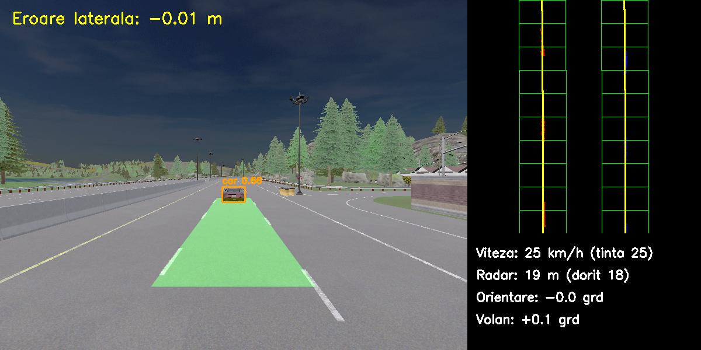

# ADAS in CARLA: lane keeping and adaptive cruise control

A small driver-assistance stack built on the CARLA simulator. The car keeps its
lane using only a front camera and keeps a safe distance to the vehicle ahead
using a radar. Everything is measured against the simulator's ground truth, and
the limits of the system are documented, not hidden.



*Left: camera image with the detected lane (green), the lead vehicle found by
YOLO, and the lateral error. Right: bird's-eye view with the sliding windows and
fitted lane lines, plus speed, radar distance and steering command.*

## What it does

| Function | Sensor | Method |
|---|---|---|
| Lane detection | Front RGB camera | Top-hat filter, perspective transform, sliding windows, polynomial fit |
| Lane keeping | (lane detection) | Stanley controller with curvature feed-forward |
| Lead vehicle tracking | Radar | Point filtering along the detected lane, moving-target tracking |
| Adaptive cruise control | (radar) | Cascade control: time-gap distance loop over a PI speed loop |
| Curve speed | (lane detection) | Speed limited by a maximum lateral acceleration |
| Vehicle detection | Front RGB camera | Pretrained YOLOv8n, display only |
| Fail-safe | (lane detection) | The car brakes to a stop if the lane is lost for 0.5 s |

No ROS, no C++, no model training: only the CARLA Python API, NumPy, OpenCV and
a pretrained YOLO model.

## Results

Seven repeatable scenarios on the Town04 highway (about 1.1 km, including a
147 m and a 54 m radius curve). All errors are measured against CARLA's ground
truth, which the controllers never see. The table is generated from the CSV
files in [`results/`](results/) by `scenarios.py`.

| Scenario | Distance driven | Lane detected | Lateral error (RMS / max) | Min. gap to lead | Latency (median / p95) |
|---|---|---|---|---|---|
| Curves, no lead vehicle | 1101 m | 99.5 % | 0.07 m / 0.32 m | n/a | 32 / 41 ms |
| Lead vehicle stops abruptly, then restarts | 604 m | 100 % | 0.07 m / 0.32 m | 6.7 m | 34 / 45 ms |
| Following at varying speed, day | 1100 m | 99.0 % | 0.06 m / 0.32 m | 18.0 m | 34 / 44 ms |
| Following at varying speed, night | 1100 m | 98.9 % | 0.06 m / 0.32 m | 18.0 m | 34 / 44 ms |
| Following, light rain | 499 m | 45.0 % | 0.25 m / 0.34 m | 18.0 m | 33 / 43 ms |
| Following, medium rain | 71 m | 3.5 % | 0.96 m / 1.00 m | 29.6 m | 32 / 42 ms |
| Following, heavy rain | 7 m | 0 % | n/a | n/a | 49 / 64 ms |

What the table shows:

- **Day, night, curves and hard braking complete the route.** The lane is
  detected in 99 to 100 % of frames and the car stays within 0.32 m of the lane
  centre. The car is 2.16 m wide in a 3.5 m lane, so it stays inside the lane
  as long as the error is below 0.67 m.
- **Night matches day.** The lane filter compares each marking with the asphalt
  next to it, so it does not depend on overall brightness.
- **Rain is not handled.** Reflections on wet asphalt defeat the brightness-based
  lane filter. In every rain scenario the plausibility checks reject the
  detection and the car brakes to a stop instead of following a wrong lane.
- **Latency fits the 50 ms control period** on a GTX 1660 Ti (6 GB), with a few
  frames over it. YOLO uses about 115 MiB of video memory.

Sensor accuracy, measured during closed-loop driving:

| Measurement | Error against ground truth |
|---|---|
| Radar distance to lead vehicle | 0.29 m RMS; below 0.75 m in 95 % of frames, curves included |
| Radar relative speed | below 0.14 m/s in 95 % of frames |
| Radar false detections on an empty road | 0 in 1100 frames |
| ACC distance error in steady state | 0.1 to 0.7 m |

## How it works

### Lane detection (`lane_detection.py`)

1. **Filtering.** A morphological top-hat on the grayscale image keeps only
   structures brighter than their local background and narrower than the
   kernel. It acts as a spatial high-pass filter, which is why it works the
   same at night.
2. **Bird's-eye view.** The camera mounting is known, so the road region from
   5 to 25 m ahead is mapped to a top-down image with a pinhole model. One
   pixel is 2.5 cm sideways and 5 cm forward.
3. **Sliding windows.** Windows follow each lane line from the bottom up. After
   the first frame they start from the previous frame's curves, so they do not
   lose dashed lines in curves.
4. **Fit.** Both lines are fitted together as parallel second-order
   polynomials (same curvature and slope, different offsets) by least squares.
5. **Plausibility.** A detection is rejected if the lane width is not
   3.5 ± 0.7 m, if the pixels do not lie on the fitted curves, or if the lane
   centre is more than 1.5 m away from the car.

The fit gives three measurements: lateral error, heading error and curvature.
Each was validated against the map before being used for control.

### Lane keeping (`controllers.py`, `lane_keeping.py`)

The steering angle is

    steer = heading_error + atan(k * lateral_error / speed) + atan(wheelbase * curvature)

The first two terms are the Stanley controller: a feedback law whose gain
drops as speed rises. The third is feed-forward: road curvature is a measured
disturbance, so it is compensated directly. The measurements are taken 6.5 m
ahead of the car, so the part of them caused only by the curve is removed
before the controller sees them. This brought the steady-state error in the
54 m curve from 0.74 m down to about 0.01 m.

### Adaptive cruise control (`radar.py`, `controllers.py`)

The radar returns a point cloud. Points are kept if they are in the car's own
lane (the search corridor follows the lane curves from the camera), above the
road, and moving; a target that was already tracked is kept even when it stops.

The controller is a cascade. The outer loop turns distance into a speed request:

    desired_gap  = 6 m + 1.8 s * own_speed
    speed_request = lead_speed + 0.3 * (gap - desired_gap)

The inner loop is a PI speed controller with anti-windup. The final speed
request is the minimum of cruise speed, curve speed and the ACC request.

### Sensor fusion

The two sensors help each other. The radar tells the camera where the lead
vehicle is, so its bright parts are not mistaken for lane markings. The camera
tells the radar where the lane goes, so it looks for the lead vehicle in the
right place in curves.

## Project layout

| File | Role |
|---|---|
| `simulation.py` | CARLA connection: map, synchronous mode, vehicles, camera, radar, weather |
| `lane_detection.py` | Lane detection and the measurements derived from it |
| `radar.py` | Lead vehicle tracking from radar points |
| `vehicle_detection.py` | YOLOv8n vehicle detection (display only) |
| `controllers.py` | Stanley, ACC and PI speed controllers |
| `lane_keeping.py` | The control loop that ties everything together |
| `metrics.py` | Per-frame CSV logging and run summaries |
| `scenarios.py` | Test scenarios and the results table |
| `display.py`, `camera_view.py`, `lane_view.py` | Window, camera viewer, lane detection viewer |

## Setup

Requirements: Windows, CARLA 0.9.16, Python 3.12, an NVIDIA GPU with CUDA.
Developed on a GTX 1660 Ti with 6 GB of video memory.

```
py -3.12 -m venv venv
venv\Scripts\python.exe -m pip install <CARLA>\PythonAPI\carla\dist\carla-0.9.16-cp312-cp312-win_amd64.whl
venv\Scripts\python.exe -m pip install torch==2.14.1 torchvision==0.29.1 --index-url https://download.pytorch.org/whl/cu126
venv\Scripts\python.exe -m pip install -r requirements.txt
```

The YOLO weights (6 MB) are downloaded automatically on first run.

## Running

Start the CARLA server first:

```
CarlaUE4.exe -quality-level=Low -ResX=800 -ResY=600 -windowed -prefernvidia
```

Then, from the project folder:

```
venv\Scripts\python.exe lane_keeping.py                                   # live demo with a lead vehicle
venv\Scripts\python.exe lane_keeping.py --log results\run.csv --steps 1200 # log metrics for 60 s
venv\Scripts\python.exe metrics.py results\run.csv                        # summarise a run
venv\Scripts\python.exe scenarios.py                                      # run all scenarios, rebuild the table
venv\Scripts\python.exe scenarios.py --table                              # rebuild the table only
```

Press ESC to stop a run.

## Known limitations

- **Rain.** Wet-road reflections defeat the lane filter; the car stops safely
  but cannot drive.
- **Highway only.** Intersections, stop lines and lane changes are out of
  scope. The Town04 highway ends in an intersection after about 1.2 km, where
  the car stops.
- **Flat-road assumption.** The bird's-eye view assumes a flat road and a
  camera that does not pitch.
- **Abrupt curve entry.** The map's curves start without a transition. Entering
  the 54 m curve the car swings 0.33 m to the outside for about a second.
- **Radar field of view.** In the 54 m curve the radar loses a lead vehicle
  that is more than about 29 m ahead.
- **Stationary vehicles.** A vehicle that is already stopped when first seen is
  ignored, because the radar cannot tell it from roadside objects.
- **Fail-safe stop.** Braking to a stop in lane is acceptable in a simulator.
  A real system would warn the driver and slow down moderately.
- **Synchronous simulation.** The simulator waits for the controller, so the
  few frames that exceed 50 ms have no effect here. On real hardware they
  would mean late commands.
- **Ground truth for vehicle motion.** Own speed is read from the simulator; a
  real car would take it from wheel odometry.
- **One map, one vehicle, one lane.** All tuning and testing was done on the
  Town04 highway with a Tesla Model 3 in the second lane.

## Possible next steps

- A lane filter that survives rain, or a learned lane detector.
- Curvature preview over a longer distance, for smoother curve entry and
  earlier braking.
- A PID baseline for the lateral controller, to compare against Stanley.
- Model predictive control, ROS 2 and a C++ implementation.

## Third-party software

- [CARLA](https://carla.org/) 0.9.16, MIT license.
- [Ultralytics YOLOv8](https://github.com/ultralytics/ultralytics), AGPL-3.0
  license. Anyone reusing this project should check what that license requires
  of them.

## Author

GitHub: [donisacosmindavid-lgtm](https://github.com/donisacosmindavid-lgtm)
